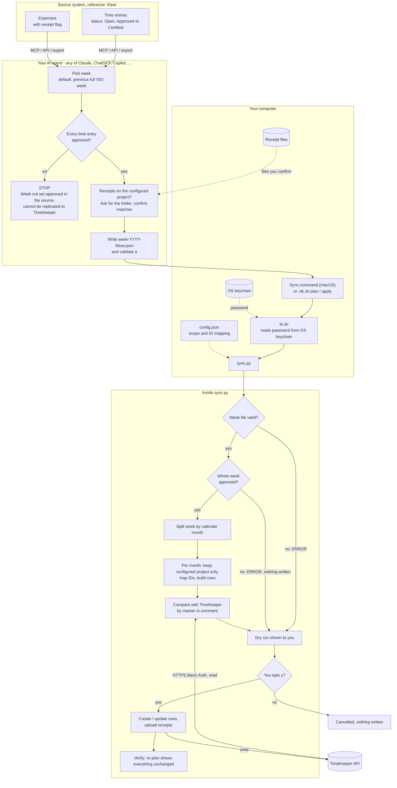
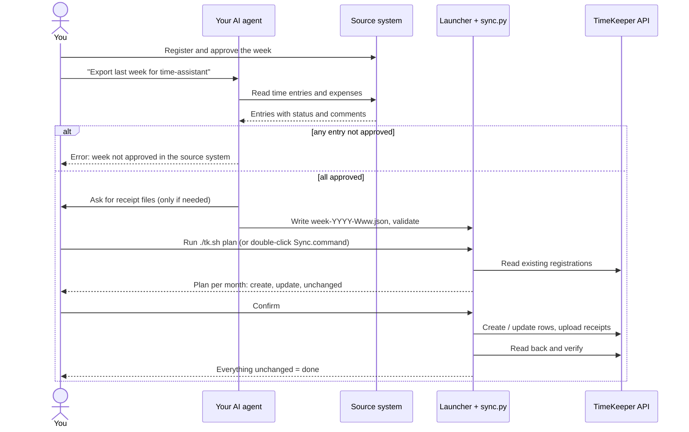

# time-assistant

Register your time and expenses **once**. Let an AI agent copy the approved week into the
second system that also wants it.

Reference setup: register in **Kleer**, replicate into **TimeKeeper**. This is typical for
consultants who book time in their employer's system and must book the same hours in a
client's or staffing partner's system. The agent does the reading; a small, dependency-free
Python script does the writing, only after you have seen a dry run.

- **Agent-neutral.** Works with Claude, ChatGPT/Codex, GitHub or Microsoft Copilot, or any
  agent that can read your time data and follow written instructions. See [docs/agents.md](docs/agents.md).
- **Approved weeks only.** An unapproved week is refused with a clear error.
- **One project in, one project out.** Everything else in the source system is ignored.
- **Safe to re-run.** Rows carry a marker, so re-runs update instead of duplicating. Your
  manual TimeKeeper rows are never touched.
- **Your password never meets the AI.** It stays in your OS keychain.
- **Receipts** are attached to expenses, matched to files you confirm.

> Status: beta. The Kleer reader and TimeKeeper dry-run are used for real; writing of
> expenses and receipt upload follows the API documentation but is covered only by
> offline tests against a fake TimeKeeper. Always read the dry run first, and please open
> an issue for anything unexpected.

## How it fits together





## Quick start

Requirements: Python 3.9+ (standard library only), a TimeKeeper account with API access,
and an AI agent that can read your source system.

```bash
git clone https://github.com/<you>/time-assistant.git
cd time-assistant

# 1. Store the TimeKeeper password in your keychain (it prompts; nothing is saved in a file)
security add-generic-password -s time-assistant -a 'YOUR-TIMEKEEPER-USERNAME' -U -w     # macOS
# Linux: secret-tool store --label=time-assistant service time-assistant account 'YOUR-TIMEKEEPER-USERNAME'

# 2. Create your configuration (git-ignored) and fill in your own IDs
cp config.example.json config.json
./tk.sh discover          # lists your TimeKeeper projects, activities and time codes

# 3. Check that the pieces work without touching anything
python3 sync.py validate --week examples/week.example.json
```

Then give your agent the instructions for its platform ([docs/agents.md](docs/agents.md))
and every week:

1. Register your time in the source system and get the week **approved**.
2. Ask your agent: *"Export last week for time-assistant."* It writes `week-YYYY-Www.json`
   next to `sync.py`.
3. `./tk.sh plan --week week-YYYY-Www.json` and read it. (macOS: double-click `Sync.command`;
   it shows the plan and asks for `y`.)
4. `./tk.sh apply --week week-YYYY-Www.json`. The verification run should show everything
   `unchanged`.

## Rules the tool enforces

**Scope.** Only the one source project in `config.json` → `scope.kleer_project_id` is
replicated, only into `scope.tk_project_id` (the *internal* TimeKeeper id, not the project
number; `discover` prints both). Everything else is ignored and listed at the end of each run.

**Approval gate.** Every time entry in the week must have an accepted status (default
`Approved`, `Certified`; configurable in `approval.accepted_statuses`; the last sentence of
the error comes from `approval.rerun_hint`, so you can name your own skill or command). Otherwise nothing is
planned or written:

```
ERROR   WEEK NOT APPROVED IN KLEER: 1 time entry (2026-10-12) not approved yet. The week has
        not yet been approved in Kleer and therefore cannot be replicated to TimeKeeper.
        Approve the week in Kleer, then run the export again.
```

**Month boundaries.** A week such as 28 Sep – 4 Oct is split into its calendar months
and each part is planned, posted and verified on its own (still one TimeKeeper row per
day). If one month fails, for example a closed period, the other is still posted and the
run ends with a message naming the failed month. Re-running is safe.

**Comments.** TimeKeeper gets the source's *external* comment. The internal comment is
never exported.

**Safety.** Dry run by default; manual TimeKeeper rows are never edited or deleted;
rows removed in the source are kept (WARN) unless `delete_stale` is on; mapping errors
block everything. Details and the full field table: [docs/data-convention.md](docs/data-convention.md).

## Repository layout

| Path | Purpose |
|---|---|
| `sync.py` | Validate, plan and apply. Standard library only |
| `tk.sh` | Runs `sync.py` with the password from your OS keychain |
| `Sync.command` | macOS double-click launcher: dry run, confirm, post, verify |
| `config.example.json` | Template for your private `config.json` (IDs and mapping) |
| `schema/week.schema.json` | The week file contract between agent and script |
| `examples/week.example.json` | A valid example week with made-up data |
| `docs/agent-playbook.md` | The agent instructions (single source of truth) |
| `docs/agents.md` | How to use it with Claude, ChatGPT, Copilot or any agent |
| `docs/data-convention.md` | Field-by-field mapping source ↔ TimeKeeper |
| `AGENTS.md`, `.github/copilot-instructions.md`, `integrations/` | Generated from the playbook by `tools/build_adapters.py` |
| `tests/` | Offline tests against a fake TimeKeeper |

## Known limits

- Mileage and allowance expense entries, and absences, are not synced.
- `isInvoiced` is always `false`; the source's invoicing state is not forwarded.
- One source project maps to one TimeKeeper project per `config.json`.
- Kleer approval is checked on time entries only, not on expenses.
- The reference reader is Kleer; other source systems need only a different export step
  (see the last section of [docs/data-convention.md](docs/data-convention.md)).

## Troubleshooting

| Symptom | Cause and fix |
|---|---|
| `security: ... item could not be found in the keychain` | The keychain account must equal your TimeKeeper username (`.tk_user`). Re-run the `security add-generic-password` command with `-U` |
| `JSONDecodeError` in `config.json` | Curly or single quotes, names instead of numeric IDs. Rebuild from `config.example.json` |
| `... is not a valid week file` | The agent's file has the wrong shape. The listed problems say what to fix; `python3 sync.py validate --week FILE` re-checks |
| `WEEK NOT APPROVED` | Approve the week in the source system, export again |
| `no complete mapping in config.json` | Add the activity or expense type to `time_map` / `expense_map` |
| HTTP 404 reading registrations | Handled as "no rows yet"; a 404 on a write still fails loudly |

## Development

```bash
python3 -m unittest discover -s tests -p "test_*.py"   # offline
python3 tools/build_adapters.py                         # after editing docs/agent-playbook.md
```

## Security and privacy

No credentials, tokens or personal data belong in this repository. `config.json`,
`.tk_user` and `week-*.json` are git-ignored; they contain your IDs and work comments.
Review a dry run before every `apply`.

## License

MIT, see [LICENSE](LICENSE). Not affiliated with Kleer or TimeKeeper.
