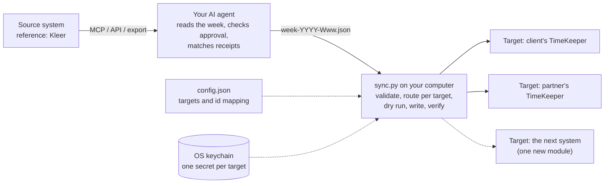
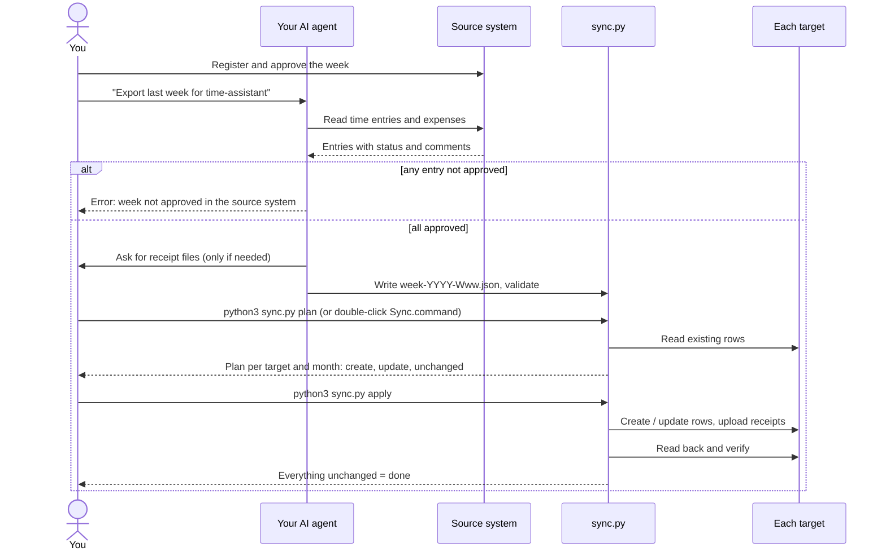

# time-assistant

Register your time and expenses **once**. Let an AI agent copy the approved week into
every other system that also wants it.

Consultants often report the same hours two or three times: in the employer's time system,
in the client's, and, when working as a subcontractor, in the staffing partner's too.
time-assistant reads the approved week from the system you register in (the **source**;
reference setup: **Kleer**) and replicates it into each of the others (the **targets**;
first supported target: **TimeKeeper**). The agent does the reading; a small,
dependency-free Python script does the writing, only after you have seen a dry run.

- **Agent-neutral.** Works with Claude, ChatGPT/Codex, GitHub or Microsoft Copilot, or any
  agent that can read your time data and follow written instructions. See [docs/agents.md](docs/agents.md).
- **Several targets, added over time.** Each target is one Python module behind a small,
  tested interface. Adding a system is a well-defined contribution:
  [docs/adding-a-target.md](docs/adding-a-target.md).
- **You decide what goes where.** Each target takes only the source projects you list for it.
- **Approved weeks only.** An unapproved week is refused with a clear error.
- **Safe to re-run.** Rows carry a tag, so re-runs update instead of duplicating. Rows you
  typed by hand in a target are never touched.
- **Your passwords never meet the AI.** They stay in your OS keychain, one per target.
- **Receipts** are attached to expenses, matched to files you confirm.
- **Daily allowances** (traktamente), domestic and foreign, go to the wage codes you choose.

> Status: beta. The Kleer reader and TimeKeeper dry-run are used for real; writing of
> expenses and receipt upload follows the API documentation but is covered only by
> offline tests against a fake TimeKeeper. Always read the dry run first, and please open
> an issue for anything unexpected.

## Supported targets

| Target | `type` | Time | Expenses | Receipts | Allowances | Status | Setup |
|---|---|:-:|:-:|:-:|:-:|---|---|
| TimeKeeper | `timekeeper` | ✓ | ✓ | ✓ | ✓ | beta | [docs/targets/timekeeper.md](docs/targets/timekeeper.md) |

Need another system? Open a *New target* issue, or build it:
[docs/adding-a-target.md](docs/adding-a-target.md). `python3 sync.py targets` lists what
your copy supports.

The **source** side needs no code: any system your agent can read works, as long as the
agent writes the week file ([docs/data-convention.md](docs/data-convention.md)).

## How it fits together





More detail, including the interface between the engine and the targets:
[docs/architecture.md](docs/architecture.md).

## Quick start

Requirements: Python 3.9+ (standard library only), an account with API access in each
target, and an AI agent that can read your source system.

```bash
git clone https://github.com/<you>/time-assistant.git
cd time-assistant

# 1. Create your configuration (git-ignored): one entry under "targets" per system
cp config.example.json config.json        # set name, username and source_project_ids

# 2. Store each target's password in your keychain (it prompts; nothing is saved in a file)
security add-generic-password -s time-assistant:client -a password -U -w      # macOS
# Linux: secret-tool store --label=time-assistant:client service time-assistant:client account password

# 3. Look up the ids each target needs, fill them in, check the file
python3 sync.py discover
python3 sync.py check-config

# 4. Check the week-file side without touching anything
python3 sync.py validate --week examples/week.example.json
```

The setup page of each target says exactly which ids it needs:
[TimeKeeper](docs/targets/timekeeper.md). Then give your agent the instructions for its
platform ([docs/agents.md](docs/agents.md)) and every week:

1. Register your time in the source system and get the week **approved**.
2. Ask your agent: *"Export last week for time-assistant."* It writes `week-YYYY-Www.json`
   next to `sync.py`.
3. `python3 sync.py plan --week week-YYYY-Www.json` and read it. (macOS: double-click
   `Sync.command`; it shows the plan for every target and asks for `y`.)
4. `python3 sync.py apply --week week-YYYY-Www.json`. The verification run should show
   everything `unchanged`.

## Several targets

Add one entry under `targets` per system. Each has its own name, login, source projects
and id mapping:

```json
"targets": [
  { "name": "client",  "type": "timekeeper", "source_project_ids": [1000001], ... },
  { "name": "partner", "type": "timekeeper", "source_project_ids": [1000001],
    "accepted_statuses": ["Certified"], ... }
]
```

- The same source project may go to several targets.
- A target can be stricter than the week gate, e.g. only take `Certified` time.
- `plan` and `apply` run every enabled target; `--target partner` runs just one;
  `"enabled": false` parks a target.
- Each target's password is stored under its own name: keychain service
  `time-assistant:<name>`.

Full example: [examples/config.two-targets.example.json](examples/config.two-targets.example.json).
Every field: [docs/configuration.md](docs/configuration.md).

## Rules the tool enforces

**Routing.** A target only receives entries from its `source_project_ids`. Everything that
no target takes is listed at the end of each run. Expenses and allowances are opt-in per
target: without an `expense_map` / `allowance_map` they are listed, not written.

**Approval gate.** Every time entry in the week, on any project, must have an accepted
status (default `Approved`, `Certified`; configurable in `approval.accepted_statuses`).
Otherwise nothing is planned or written for any target. The last sentence of the error
comes from `source.rerun_hint`, so you can name your own skill or command:

```
ERROR   WEEK NOT APPROVED IN KLEER: 1 time entry (2026-10-12) not approved yet. The week has
        not yet been approved in Kleer and therefore cannot be replicated to any target.
        Approve the week in Kleer, then run the export again.
```

**Errors block writing everywhere.** An unmapped activity, a missing receipt or a target
that cannot be reached shows up in the dry run, and `apply` then writes nothing at all. Use
`--target` to write only the targets without errors.

**Month boundaries.** For targets that work per month (TimeKeeper does), a week such as
28 Sep – 4 Oct is split into its calendar months and each part is planned, written and
verified on its own. If one month or one target fails while writing, for example a closed
period, the rest is still written and the run ends naming what failed. Re-running is safe.

**Comments.** Targets get the source's *external* comment. The internal comment is never
exported.

**Safety.** Dry run by default; rows typed by hand are never edited or deleted; rows
removed in the source are kept (WARN) unless the target has `delete_stale` on. Details:
[docs/data-convention.md](docs/data-convention.md).

## Updating

```bash
python3 sync.py version          # where you are
git pull                         # or "Sync fork" on GitHub first
python3 sync.py check-config     # ERROR must be fixed; NOTE = optional new features
```

Then read the **Upgrading** notes in [CHANGELOG.md](CHANGELOG.md) for each version you
skipped, and refresh your agent's instructions if the playbook changed. `sync.py` warns
when a week file was exported with outdated instructions. Step by step, per agent:
[docs/updating.md](docs/updating.md).

Coming from the single-TimeKeeper version (0.1)? `python3 sync.py migrate-config`
converts `config.json` once and keeps a backup; [CHANGELOG.md](CHANGELOG.md#020---2026-10-11)
has the rest.

## Repository layout

| Path | Purpose |
|---|---|
| `sync.py` | The command: version, validate, check-config, discover, plan, apply. Standard library only |
| `time_assistant/` | The code: `engine.py` (target-independent), `targets/` (one module per target), config, week file, credentials |
| `Sync.command` | macOS double-click launcher: dry run, confirm, write, verify |
| `config.example.json` | Template for your private `config.json` |
| `schema/week.schema.json` | The week file contract between agent and script |
| `examples/` | A valid example week and a two-target example config |
| `docs/agent-playbook.md` | The agent instructions (single source of truth) |
| `docs/architecture.md` | How the pieces fit and the target interface |
| `docs/configuration.md` | Every field of `config.json` |
| `docs/targets/` | One setup page per target |
| `docs/adding-a-target.md` | How to add a target |
| `CHANGELOG.md`, `docs/updating.md` | What changed in each version, and how to update |
| `docs/data-convention.md` | Source → week file, how rows are recognised, and the semantic table: every piece of data in every system |
| `AGENTS.md`, `.github/copilot-instructions.md`, `integrations/` | Generated from the playbook by `tools/build_adapters.py` |
| `tests/` | Offline tests; `tests/target_contract.py` is the suite every target must pass |

## Known limits

- Mileage entries and absences are not synced.
- Allowances are written as one row with the source's total, not as days × daily rate.
- The source's invoicing state is not forwarded.
- Approval is checked on time entries only, not on expenses.
- The reference source is Kleer; other source systems need only a different export step
  (see [docs/data-convention.md](docs/data-convention.md)).
- Two targets in the same account must use different projects; `check-config` refuses
  otherwise. Target-specific limits are on each target's page.

## Troubleshooting

| Symptom | Cause and fix |
|---|---|
| `No password found for target '<name>'` | Store it with the command printed below the message (keychain service `time-assistant:<name>`, account `password`) |
| `uses the old single-TimeKeeper format` | Run `python3 sync.py migrate-config` once |
| `config.json is not valid JSON` | Curly or single quotes, a missing comma. Compare with `config.example.json` |
| `config.json has N problem(s)` | The list says what to fix; `python3 sync.py check-config` re-checks |
| `... is not a valid week file` | The agent's file has the wrong shape. `python3 sync.py validate --week FILE` re-checks |
| `WEEK NOT APPROVED` | Approve the week in the source system, export again |
| `only takes entries with status ...` | That target is stricter; wait, or write the others with `--target` |
| `has no mapping in time_map of target` | Add the activity or expense type to that target's `time_map` / `expense_map` |
| Something specific to one system | See its page under [docs/targets/](docs/targets/) |

## Contributing

New targets, fixes and docs are welcome. Start with [CONTRIBUTING.md](CONTRIBUTING.md);
for a new system, [docs/adding-a-target.md](docs/adding-a-target.md) walks through it and
the shared contract tests tell you when it is done.

```bash
python3 -m unittest discover -s tests -p "test_*.py"   # offline, no accounts needed
python3 tools/build_adapters.py                         # after editing docs/agent-playbook.md
```

## Security and privacy

No credentials, tokens or personal data belong in this repository. `config.json`,
`.tk_user` and `week-*.json` are git-ignored; they contain your ids and work comments.
Review a dry run before every `apply`.

## License

Apache License 2.0, see [LICENSE](LICENSE). Not affiliated with Kleer, TimeKeeper or any
other system mentioned here.
