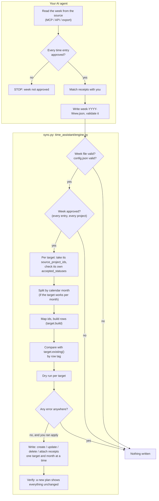

# Architecture

time-assistant has two halves joined by one file:

1. **Export (your AI agent).** Reads one week from the source system, checks that it is
   approved, matches receipts with you, and writes `week-YYYY-Www.json`. Instructions:
   [agent-playbook.md](agent-playbook.md). The agent never talks to a target and never
   sees a password.
2. **Replicate (`sync.py` on your computer).** Validates the week file, sends each entry
   to the targets configured for its project, shows a dry run, and writes only what
   differs.

## Code layout

| Module | Job |
|---|---|
| `sync.py` | Entry point; puts the package on the path and calls the CLI |
| `time_assistant/cli.py` | Commands: `validate`, `check-config`, `targets`, `discover`, `plan`, `apply`, `migrate-config` |
| `time_assistant/week.py` | Reads and validates the week file ([schema](../schema/week.schema.json)) |
| `time_assistant/config.py` | Reads and checks `config.json`; converts the old format |
| `time_assistant/engine.py` | Everything target-independent: approval, routing, month split, compare, write, output |
| `time_assistant/markers.py` | Row tags (`[ta:t:<id>]`) that make re-runs safe |
| `time_assistant/credentials.py` | Per-target secrets: environment → macOS keychain → Linux secret service → prompt |
| `time_assistant/targets/base.py` | The `Target` interface |
| `time_assistant/targets/<type>.py` | One module per target system |

The engine never imports a specific target. It only calls the interface below, so a new
target needs no change outside its own module, its tests and its docs page.

## The target interface

A target subclasses `time_assistant.targets.Target`, declares what it can do, and
implements a handful of methods. Full docstrings are in
[`targets/base.py`](../time_assistant/targets/base.py).

| Declared | Meaning |
|---|---|
| `type`, `display_name` | `"timekeeper"` in config.json, `"TimeKeeper"` in output |
| `supports_expenses`, `supports_receipts` | What the system can store; the engine reports what it skips |
| `split_by_month` | Plan, write and verify each calendar month separately |
| `needs_username`, `secrets` | `username` comes from config.json; secrets (`password`, `token`) from the keychain |
| `required_settings`, `time_map_fields`, `expense_map_fields` | Checked offline by `check-config` |

| Method | Called by the engine to |
|---|---|
| `existing(kind, from, to)` | Read the rows already there, as `Existing(id, key, date, project, raw)` |
| `build(kind, item, mapping)` | Turn one week-file entry into a `Wanted(payload, project)` |
| `same(kind, existing, wanted)` | Decide between *unchanged* and *update* |
| `create` / `update` / `delete` | Write |
| `attached_files` / `attach_receipt` | Receipts, only if `supports_receipts` |
| `discover()` | Print the ids a person needs for config.json |
| `check_settings(config)`, `identity(config)` | Extra offline checks; refuse two targets writing to the same place |

`kind` is `"time"` or `"expense"`. `key` is the source id read from the row's tag
(`None` for rows typed by hand, which are never changed).

## Guarantees and where they live

| Guarantee | Where |
|---|---|
| Nothing is written for an unapproved week | `engine.approval_errors`, before any target is contacted |
| Each target gets only its projects | `engine.route` |
| An error anywhere means nothing is written | `engine.run` refuses `apply` |
| Re-runs never duplicate; hand-typed rows are never touched | Row tags (`markers.py`) + `engine.diff` |
| Rows are never deleted unless `delete_stale`, and never while a mapping is incomplete | `engine.build_plan` |
| One month or one target failing does not block the rest | `engine.run` writes each target and month on its own |
| Targets sharing an account don't see each other's rows | Each target's `existing()` returns only its own scope; `config.check` refuses identical scopes |
| Every target behaves the same way | `tests/target_contract.py`, run against every built-in target |
