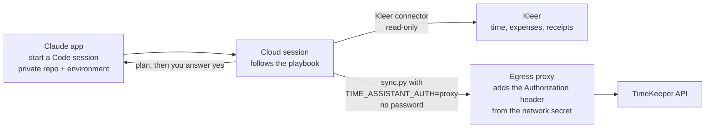

# Run it from your phone: Claude cloud sessions

Register in Kleer, get the week approved, then replicate it from the Claude app on your
phone or on the web, without a computer. The whole run happens in a **Claude Code cloud
session** on a private copy of this repository: export, dry run, your yes, writing. The
TimeKeeper login is held by the cloud environment as a **network secret**, so neither the
agent nor the script ever sees your password.

The computer route (keychain, `config.json` file) is unchanged and independent.

Menus and names in Claude change often. Where this page names a setting, look it up in
Claude's documentation for Claude Code on the web if you cannot find it.



## What you need

| Need | Why |
|---|---|
| A Claude plan with Claude Code on the web and **network secrets** for cloud environments | The secret holds the login; check your plan's documentation |
| A GitHub account and a **private** repository holding a copy of this code | The session works on a repository |
| The Kleer connector added to your Claude account | The agent reads Kleer |
| A working `config.json` on a computer, once | You build the environment variables from it ([getting-started.md](getting-started.md) steps 1 to 6) |

## One-time setup (on a computer)

### 1. A private copy of the repository

A *fork* of a public repository stays public. Nothing personal is committed here (your
config, week files and receipts are git-ignored), so that would not leak anything, but a
private copy is tidier:

```bash
git clone https://github.com/<you>/time-assistant.git
cd time-assistant
# create an EMPTY private repository on GitHub first, then:
git remote add private git@github.com:<you>/time-assistant-private.git
git push private main
```

Connect GitHub to your Claude account and give it access to that repository.

### 2. Build the environment variables

From your working `config.json` (ids only, no secrets):

```bash
python3 tools/make_cloud_env.py
```

It writes `cloud-environment-variables.txt` (git-ignored) with two lines:

```text
TIME_ASSISTANT_AUTH=proxy
TIME_ASSISTANT_CONFIG_JSON='{"version":2, ... your config without notes ...}'
```

Run it again whenever you change `config.json`, and paste the new lines into the
environment.

### 3. Create the cloud environment

In Claude Code on the web, create an environment and set:

- **Network access: Custom**, with the allowed domain `api2.timekeeper.se` (keep the
  default allowed domains too).
- **Environment variables:** the two lines from `cloud-environment-variables.txt`.

### 4. Add the network secret (the login)

Edit the environment again and add a **network secret**:

| Field | Value |
|---|---|
| Allowed website | `api2.timekeeper.se` |
| Header name | `Authorization` |
| Prefix | `Basic` |
| Value | base64 of `username:password` |

Create the value without ever showing the password, copy it straight to the clipboard,
paste it into the secret, then clear the clipboard:

```bash
# zsh
read "u?TimeKeeper username: "; read -s "p?TimeKeeper password: "; echo
printf '%s:%s' "$u" "$p" | base64 | tr -d '\n' | pbcopy; unset u p      # pbcopy: macOS
pbcopy < /dev/null                                                       # after pasting
```

(Linux: pipe to `xclip -selection clipboard` or `wl-copy` instead of `pbcopy`.)

### 5. Add the Kleer connector

Make sure the Kleer connector is added to your Claude account and enabled for cloud
sessions.

## First-run check

Start a Claude Code session on your private repository with that environment and ask:

> Run `python3 sync.py discover` and tell me what you see.

It must list your TimeKeeper projects.

| Result | Meaning |
|---|---|
| Lists projects | Done |
| `HTTP 401` | The secret's value or prefix is wrong: re-create the base64 value, header `Authorization`, prefix `Basic` |
| `HTTP 403`, "host not allowed" or a network error | `api2.timekeeper.se` is missing from the environment's network access |
| `config.json not found` | `TIME_ASSISTANT_CONFIG_JSON` is missing or not valid JSON; rebuild it with `make_cloud_env.py` |

Do not try to debug by printing environment variables; the session is told not to, and the
password is not in them anyway.

## Every week

1. Register your time and expenses in Kleer and get the week **approved**.
2. In the Claude app start a Code session with your private repository and the environment
   (Kleer connector on) and say: **"Sync last week to TimeKeeper."** (Another week: *"Sync
   week 2026-W42"*.)
3. The agent states the dates, checks approval, writes the week file, and shows the
   **dry run**, line by line.
4. Read it. Answer **yes** to *"Post this to the targets? (yes/no)"* only if it is right. If
   anything changed after you saw the plan, it plans and asks again.
5. After writing it runs the plan once more; everything should be unchanged.

## What the agent does with receipts

Without a folder on your computer, the agent fetches each receipt from Kleer by the
receipt's own file id and decodes it with `tools/save_receipt.py`, which writes the file
only if it is a real JPEG, PNG or PDF. It tells you which receipts it fetched. If a receipt
is too large or truncated, it asks you to attach the file to the chat instead. Receipts are
stored under `receipts/` and never committed.

## Rules the session follows

- Never asks for, prints or looks for credentials; never prints environment variables.
- Read-only on Kleer.
- Only approved weeks.
- Never commits or pushes week files, receipts or config.
- Never runs `apply` unattended: only after your yes to the plan it just showed.
- Exports every entry with its real project id; `sync.py` filters and lists what it ignored.

The full text is in [agent-playbook.md](agent-playbook.md#cloud-sessions-phone-or-web).

## Keeping it up to date

| When | Do |
|---|---|
| New version of time-assistant | Pull it into your private copy (`git pull` from the public repository, then push to `private`); read [CHANGELOG.md](../CHANGELOG.md) "Upgrading" |
| You change `config.json` (new project, activity, expense project id) | `python3 tools/make_cloud_env.py`, paste the new `TIME_ASSISTANT_CONFIG_JSON` into the environment |
| You change your TimeKeeper password | Re-create the base64 value and replace the network secret |

## Security notes

- The login lives only in the network secret; the egress proxy adds it to requests for
  `api2.timekeeper.se`. It is never in the session, the repository or the environment
  variables.
- The environment variable holds ids only. Your week files contain work comments: they stay
  in the session and are never committed.
- Anyone who can start a session in your environment can write to your TimeKeeper with it, so
  keep the repository and the environment private to you.

## Limits

The same as the computer route ([README](../README.md#known-limits)), plus: the session
cannot use your computer's folders, so receipts come from Kleer or from files you attach,
and macOS's `Sync.command` is not used.
