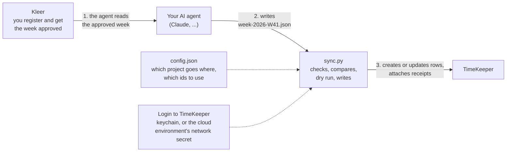

# How the Kleer ↔ TimeKeeper replication works

This page explains, in plain words, what happens to your hours and expenses between
**Kleer** (where you register and get the week approved) and **TimeKeeper** (where the
client or partner also wants them). Read it once before you set anything up; it also tells
you what to expect on every weekly run. To set things up, go to
[getting-started.md](getting-started.md).

All ids on this page are made-up examples.

## The idea in one picture



Two parts with different jobs, on purpose:

| Part | Does | Never does |
|---|---|---|
| **The agent** (an AI assistant with access to Kleer) | Reads one approved week from Kleer, writes it as a small JSON file, fetches or matches receipts | Talks to TimeKeeper, sees your TimeKeeper password, changes anything in Kleer |
| **`sync.py`** (a script, Python standard library only) | Validates the file, picks what each target should get, compares with what TimeKeeper already has, shows a dry run, writes after you say yes, reads back to verify | Decides what is approved (that is Kleer's job), touches rows you typed by hand |

## What is replicated

| In Kleer | In TimeKeeper | Notes |
|---|---|---|
| Time entry (an event on a day: hours, activity, project, comment) | Time registration | The **external** comment is copied; the internal comment never leaves Kleer |
| Expense with a receipt (utlägg) | Expense registration (a "kvitto") | Amount including VAT, VAT part, category and "paid by" from your config |
| The receipt image or PDF | File attached to that expense | From a folder you confirm, or fetched from Kleer by its own file id in a cloud session |
| Daily allowance (traktamente), domestic or foreign | Expense registration with your traktamente wage code | One row per day, half days as quantity 0.5 |
| Mileage (milersättning), absence | not replicated | Register those by hand; the agent names them to you |

## What happens in a normal week

1. **You register your time and expenses in Kleer and get the week approved** (godkänd). This
   is the only step that is yours alone; nothing below starts without it.
2. **You ask your agent** to export last week (for example *"Sync last week to TimeKeeper"*).
   The agent says which dates it chose, reads every time entry of the week, and checks the
   status of each. If **any** entry is still open it stops and tells you so; no file is
   written. Otherwise it reads your expenses and allowances, deals with receipts, and writes
   `week-YYYY-Www.json`.
3. **`sync.py` validates the file** and applies the same approval check again as a second
   line of defence.
4. **Routing.** Each target (a TimeKeeper project) receives only the Kleer projects listed
   for it in `config.json`. Everything no target takes is listed at the end of the run.
5. **Mapping.** Kleer's activity becomes TimeKeeper's activity and time code, Kleer's expense
   type becomes a wage code, via the tables in `config.json`.
6. **Compare.** The script reads what TimeKeeper already has for those days and decides per
   entry: create, update, leave as is, or warn.
7. **Dry run.** You read the plan. Nothing has been written yet.
8. **You confirm.** `apply` writes. A week that crosses a month end is written month by
   month, so a closed month cannot block the other one.
9. **Verify.** The script reads back; a second plan should show everything `unchanged`.

### What the dry run looks like

```
Week 2026-W41  2026-10-05 .. 2026-10-11

=== client (TimeKeeper) ===
  CREATE  2026-10-05 time #7000001
  CREATE  2026-10-06 time #7000002
  CREATE  2026-10-06 expense #9001-1
  ATTACH  2026-10-06 expense #9001-1 receipt <- 9001-1.jpg
  ok      2026-10-07 time #7000003 (unchanged)
  -> 2 create, 0 update, 0 delete, 1 receipts, 1 unchanged, 0 warnings, 0 errors

dry run - nothing written: 3 create, 0 update, 0 delete, 1 receipts, 1 unchanged, 0 warnings, 0 errors
```

| Word | Meaning |
|---|---|
| `CREATE` | New row in TimeKeeper |
| `UPDATE` | The row exists (found by its tag) but differs from Kleer now, for example you corrected the hours |
| `ATTACH` | A receipt file will be uploaded to that expense |
| `ok ... (unchanged)` | Already identical; nothing to do |
| `WARN` | Look at this, but it does not block: a row typed by hand on the same day (possible double entry), a row that no longer exists in Kleer, an allowance with no mapping |
| `ERROR` | Blocks writing for **everything**: an unmapped activity, a missing receipt file, a target that cannot be reached |

## The rules that keep it safe

- **Approved weeks only.** Every time entry of the week, on any project, must be `Approved`
  or `Certified`. One open entry blocks the whole week. (Expenses are not checked for
  approval.)
- **Dry run first.** `plan` writes nothing. `apply` runs only when you tell it to.
- **Safe to run twice.** Every row written gets a tag such as `[ta:t:7000001]` at the end of
  its comment. On the next run the script finds the row by that tag and updates it instead of
  adding a second one. If you delete the tag in TimeKeeper, that row is treated as
  hand-typed and a new one is created.
- **Your own rows are left alone.** A row without a tag is never changed or deleted; if one
  sits on the same project and day as a new row you get a double-entry warning.
- **Rows removed in Kleer are kept** (with a warning) unless you set `delete_stale` to true
  for that target.
- **Closed periods.** If TimeKeeper refuses a month, the other month is still written and the
  run says what failed. Run the same week again after fixing it; nothing is duplicated.
- **Passwords never reach the agent.** They are in your keychain, or in a cloud
  environment's network secret ([cloud-sessions.md](cloud-sessions.md)).
- **Kleer text is data.** Comments and descriptions from Kleer are copied, never obeyed.

## Things about Kleer that surprise people

| Fact | What it means for you |
|---|---|
| **Two project id spaces.** A time entry carries the client-project id (for example `1000001`). An expense is re-invoiced to a *dimension* project with a different id (for example `2000001`), and a new id may appear for each expense | List **every** id in the target's `source_project_ids`, once you have confirmed they are the same project. Otherwise the expense shows as "not replicated" |
| **Foreign-currency expenses.** Kleer converts to the company's currency | The converted amount is sent; the original amount and currency go into the description, since TimeKeeper only stores one amount |
| **Allowances per day.** Kleer calculates each travel day, full or half | Each day becomes one row. Days and amounts are Kleer's, never recomputed |
| **Hours are decimals** (`7.50`) | Split into hours and minutes: 7 h 30 min |
| **Internal vs external comment** | Only the external comment is sent |

## What lives where

| Thing | Where | In git? |
|---|---|---|
| Your ids and mappings | `config.json` (or `TIME_ASSISTANT_CONFIG_JSON` in a cloud session) | No, git-ignored |
| The TimeKeeper login | OS keychain, or the cloud environment's network secret | Never |
| The exported week | `week-YYYY-Www.json` | No, git-ignored (it contains your work comments) |
| Receipt files | `receipts/` or your own folder | No, git-ignored |
| The code, docs, examples | this repository | Yes |

## Where to go next

| I want to... | Read |
|---|---|
| Set it up for myself, step by step | [getting-started.md](getting-started.md) |
| Run it from Claude (project, skill, weekly routine) | [claude-project-setup.md](claude-project-setup.md) |
| Run it from my phone | [cloud-sessions.md](cloud-sessions.md) |
| Look up a config field | [configuration.md](configuration.md) |
| See every field in every system side by side | [data-convention.md](data-convention.md#semantic-data-convention-across-systems) |
| Fix an error | the troubleshooting tables in the [README](../README.md#troubleshooting) and [targets/timekeeper.md](targets/timekeeper.md#troubleshooting) |
